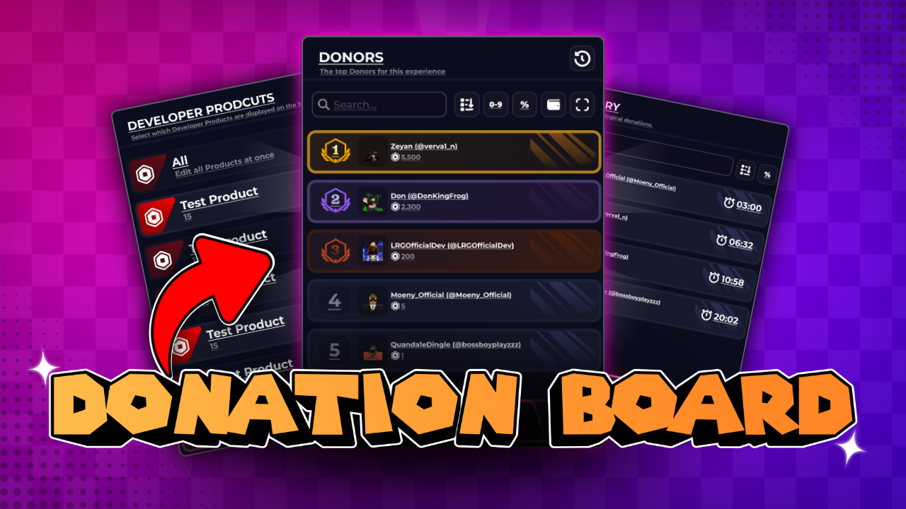
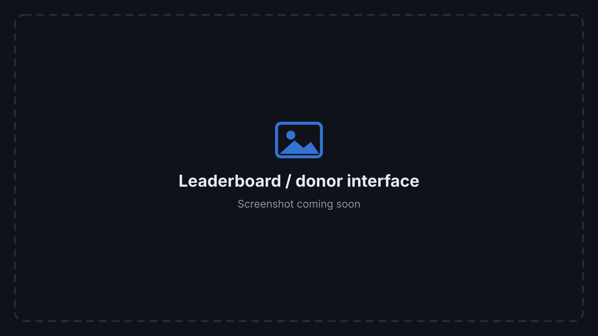
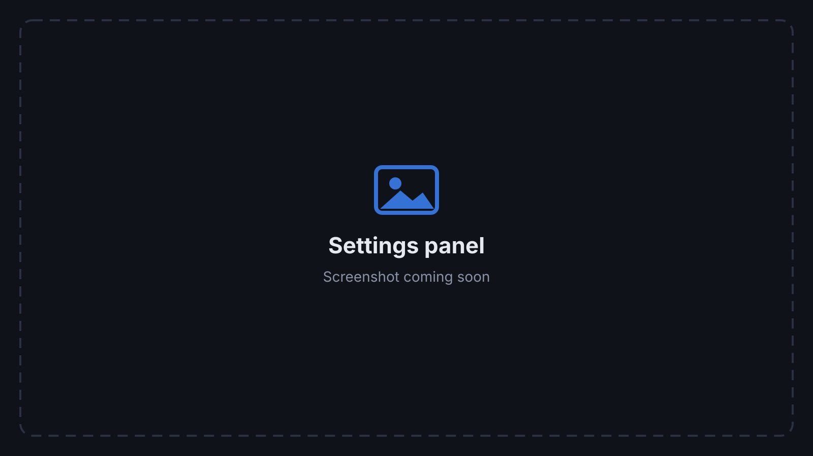

Donation Board has been part of Dev Equip for a while now. Over the years, it's grown into one of our most recognised products, helping developers give their players a way to support their games and recognise their biggest supporters.

Now, we're introducing **Donation Board V5**.

V5 isn't simply another visual refresh. We've taken the opportunity to revisit how the board is structured, how its different systems work together and how developers interact with it. The goal was to create something that feels more cohesive, is easier to work with and gives us a better foundation to build upon.

## A new look

*The redesigned V5 leaderboard*

The first thing you'll notice is the redesigned interface.

We've moved away from the previous layout and reworked the overall presentation of the board. Navigation, spacing and individual UI elements have all been reconsidered to create a more consistent experience.

Rather than adding complexity, the focus has been on making the important parts of the board easier to access. Whether players are browsing the leaderboard or looking to make a donation, the experience should feel straightforward.

## Behind the board

<!-- 

*Leaderboard and donor interface* -->

A lot of the work in V5 goes beyond what you can see.

We've been revisiting the underlying systems that power Donation Board, with a focus on keeping things organised and making future development easier. Data management, settings and the way different parts of the board communicate have all received attention.

The leaderboard remains at the centre of the experience, tracking player contributions and organising donors by their total donations. Individual donation records also allow contributions to be tracked beyond a single lifetime total.

<!-- ## More control over your board

*The settings panel* -->

V5 continues to give developers control over how Donation Board behaves in their game.

From adjusting interface visibility to configuring existing board options, the settings are designed to make managing the experience less dependent on manually editing the model.

We've also kept the familiar developer product management workflow, allowing you to choose which products players can purchase directly through the board.

## Built for what's next

V5 gives Donation Board a new foundation.

Instead of continuing to build on top of an increasingly complicated structure, we've used this release to rethink parts of the product and establish a cleaner direction for future updates.

There are still plenty of ideas we'd like to explore, and V5 gives us a better starting point to bring them to life.

## Where to get it

Donation Board V5 is available on the [Roblox Creator Store](https://create.roblox.com/store/asset/73918667474258/Donation-Board-v50).

For more information, check out the [Developer Forum post](https://devforum.roblox.com/t/monetize-your-roblox-game-donation-board-50/4989541).

## Getting started

Getting Donation Board V5 into your game is simple.

1. Get the model from the [Roblox Creator Store](https://create.roblox.com/store/asset/73918667474258/Donation-Board-v50).
2. Insert the model into your Roblox experience.
3. Position the board wherever you'd like players to interact with it.
4. Configure the required game security settings and API access.
5. Launch your game and let your players start supporting it.

## Available for everyone

Donation Board has always been free, and V5 is no different.

We believe useful development tools should be accessible to everyone, regardless of the size of their project. Whether you're working on your first Roblox experience or managing an established game, Donation Board is designed to make accepting and recognising donations easier.

We're excited to see what you build with V5.

Get Donation Board V5 from the [Creator Store](https://create.roblox.com/store/asset/73918667474258/Donation-Board-v50), read more on the [Developer Forum](https://devforum.roblox.com/t/monetize-your-roblox-game-donation-board-50/4989541) and join the community in our [Discord server](https://discord.gg/VhTpGXugHg).
